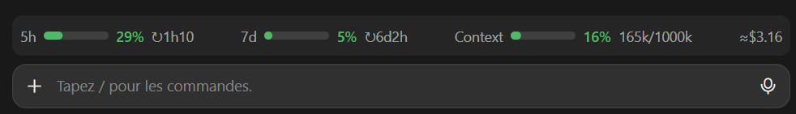

# usage-bar

A band above the Claude Code prompt that shows, at a glance, how much of your plan you have used:



In a terminal, the bars are drawn with block characters instead.

- **5h**: the rolling five-hour window, percent used and time until it resets
- **7d**: the weekly window, percent used and time until it resets
- **Context**: how full the current conversation's context window is
- **≈$**: API-equivalent cost of the session (an estimate; a Pro/Max plan is not billed per request)

Bars turn yellow at 70% and red at 90%. Run `/usage-bar` to hide or show the band; the choice is remembered. Rate-limit figures appear on a Claude subscription only, after the first reply of a session. Nothing is sent anywhere: the figures come from Claude Code itself.

## Install

At the prompt of a Claude Code terminal session:

```
/plugin install usage-bar --marketplace xendo3000/claude-token-consumption-bar
```

From a shell:

```
claude plugin install usage-bar --marketplace xendo3000/claude-token-consumption-bar
```

Answer `y` to add the marketplace, then pick the **user** scope so the band shows in every session.

In the desktop app: click **+** next to the prompt box, then **Plugins**, **Add marketplace** with `xendo3000/claude-token-consumption-bar`, then **Add plugin**.

## Uninstall

From a shell:

```
claude plugin uninstall usage-bar
```

Or at the prompt of a Claude Code terminal session: `/plugin uninstall usage-bar`. To only hide the band without uninstalling, run `/usage-bar`.
